<p align="center">
  
</p>

<p align="center">
  <a href="https://github.com/AKANEMO22"></a>
  <a href="https://www.facebook.com/akaware383"></a>
  <a href="https://github.com/AKANEMO22?tab=followers"></a>
  
</p>

---

### Abstract

> I am an Artificial Intelligence student at FPT University who builds end-to-end AI systems that leave the
> notebook and reach real users. This profile reports on work spanning conversational LLM agents, retrieval
> pipelines and how to evaluate them, voice interfaces (TTS/STT), and explainability for high-stakes domains.
> Results suggest a strong preference for shipping over theorising, and a non-trivial correlation between
> deadlines and commit frequency (see Figure 2).
>
> **Keywords** — applied AI · LLM agents · retrieval-augmented generation · speech interfaces · explainable AI

---

### 1&nbsp;&nbsp;Introduction

| | |
|:--|:--|
| **Affiliation** | B.Sc. Artificial Intelligence, FPT University, Vietnam |
| **Research focus** | Multi-agent LLM systems, RAG evaluation methodology, causal explainability |
| **Interests** | Applied NLP, information retrieval, interactive visualisation of ML architectures |
| **Currently seeking** | Internships, research collaboration, open-source contributions |

---

### 2&nbsp;&nbsp;Methods

**2.1&nbsp; Languages**&nbsp;&nbsp;


**2.2&nbsp; Machine learning & data**&nbsp;&nbsp;


**2.3&nbsp; Web & backend**&nbsp;&nbsp;


**2.4&nbsp; Tooling**&nbsp;&nbsp;


---

### 3&nbsp;&nbsp;Experiments

*Table 1. Selected projects, ordered by scope.*

| # | Project | Contribution | Stack |
|:-:|:--|:--|:--|
| 1 | [**Coc Di Lam**](https://github.com/AKANEMO22/Coc-di-lam) | Voice-based OJT interview practice platform. Full monorepo covering backend, frontend, core AI agent, speech TTS/STT, RAG and evaluation, with CV–JD gap analysis. | Python · TypeScript |
| 2 | [**Retrieval Evaluation Harness**](https://github.com/AKANEMO22/retrieval-evaluation-harness) | Evaluation framework for search and RAG systems: IR metric computation, error taxonomy, clean architecture. | Python |
| 3 | [**Transformer 3D Simulator**](https://github.com/AKANEMO22/Transformer-2017-3D-Simulator) | Interactive 3D reconstruction of Figure 1 from Vaswani et al. (2017), backed by Keras 3. | TypeScript · R3F |
| 4 | [**MedTCAX**](https://github.com/AKANEMO22/MedTCAX-Causal-Argumentative-Explainability) | Causal and argumentative explainability applied to medical prediction tasks. | Python · Jupyter |
| 5 | [**AI Anti-Scam Guardian**](https://github.com/AKANEMO22/ai-anti-scam-guardian) | AI-assisted detection and alerting for online scam content. | Python |
| 6 | [**SCAR-X**](https://github.com/AKANEMO22/SCAR-X) | Research codebase under active development. | Python |

---

### 4&nbsp;&nbsp;Results

<p align="center">
  
</p>

<sub>Figure 2 is regenerated daily from the GitHub GraphQL API by <a href="scripts/generate.py"><code>scripts/generate.py</code></a> via GitHub Actions. No third-party stats service is involved.</sub>

---

### 5&nbsp;&nbsp;Citation

If any of this work was useful to you, please consider citing this profile:

```bibtex
@misc{chimi2026profile,
  author       = {Do Chimi},
  title        = {AKANEMO22: Building Applied AI Systems, One Commit at a Time},
  year         = {2026},
  institution  = {FPT University},
  howpublished = {\url{https://github.com/AKANEMO22}},
  note         = {Correspondence via GitHub issues or Facebook}
}
```

<sub><b>Acknowledgements.</b> Thanks to my teammates at FPT University, the open-source community, and an unreasonable amount of coffee.</sub>
